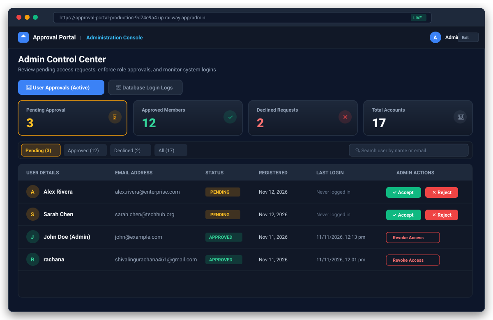
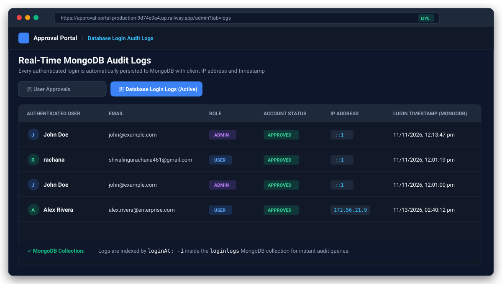
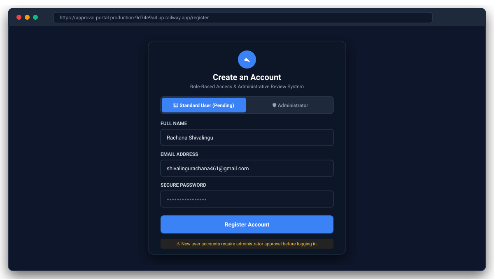
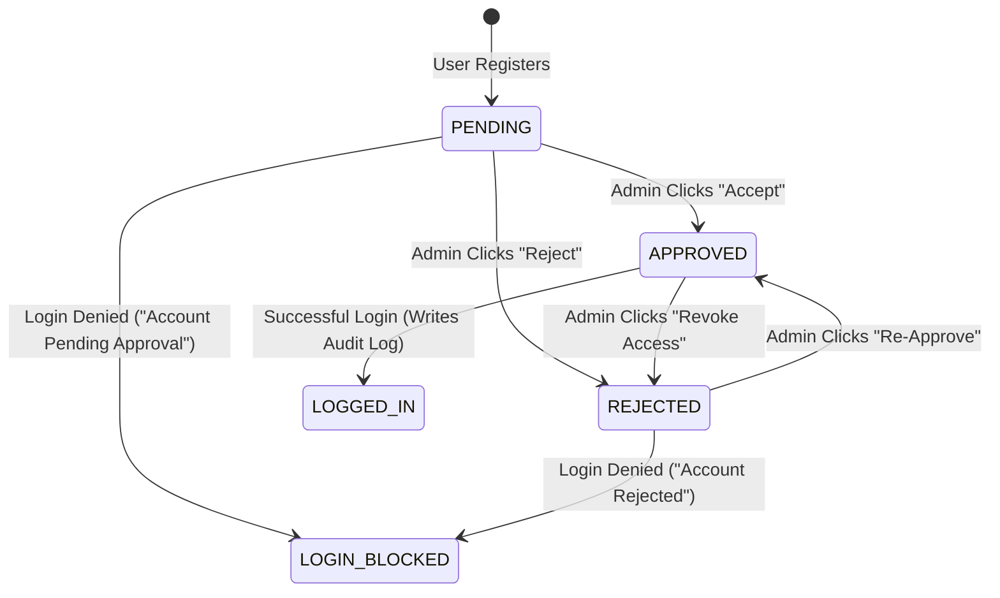
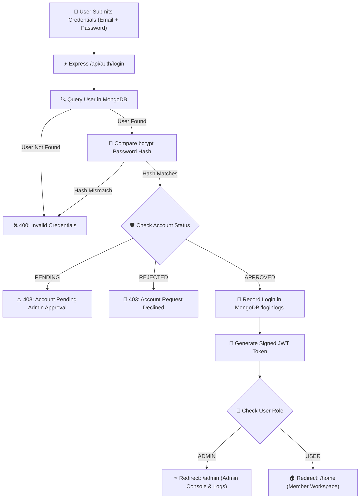
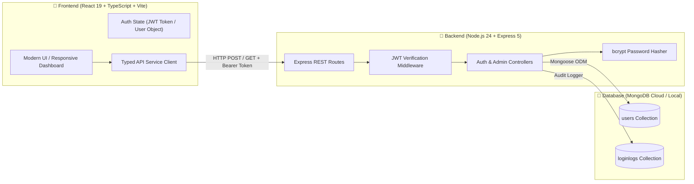

# 🛡️ Approval Management System
### Enterprise Role-Based Authentication & Administrative Approval Portal

[-10b981?style=for-the-badge&logo=railway&logoColor=white)](https://approval-portal-production-9d74e9a4.up.railway.app)
[](https://github.com/shivalingurachna/Approval-Management-System)
[](https://github.com/shivalingurachna/Approval-Management-System)
[](https://github.com/shivalingurachna/Approval-Management-System)

> **🚀 Live Production Application:** [https://approval-portal-production-9d74e9a4.up.railway.app](https://approval-portal-production-9d74e9a4.up.railway.app)  
> **📦 GitHub Repository:** [https://github.com/shivalingurachna/Approval-Management-System](https://github.com/shivalingurachna/Approval-Management-System)

---

## 📸 Application Screenshots

### 1. Administration Console & Approval Workflow
The administrative dashboard allows privileged operators to review incoming user requests, monitor live status counters, and approve, decline, or revoke access with real-time feedback.



---

### 2. Real-Time MongoDB Database Login Audit Logs
Every user and administrator login is automatically captured with client IP address, authenticated role, account status, and MongoDB server timestamp.



---

### 3. Role-Based Authentication & Registration Portal
Users can sign up for standard membership (automatically placed into `PENDING` review) or register designated administrative credentials.



---

## 📊 Core Features & Workflow Charts

### 1. User Approval State Machine
Every standard user follows a strictly enforced lifecycle state machine:



---

### 2. Authentication & Authorization Security Flowchart
How incoming HTTP requests are processed through JWT authentication, role guards, and approval gates:



---

### 3. Full-Stack System Architecture



---

## 🌟 Comprehensive Feature Matrix

| Feature | Description | Implementation Details |
| :--- | :--- | :--- |
| **Two-Tier Role Authentication** | Distinct permissions for `ADMIN` and `USER` roles. | Enforced via `authMiddleware.js` and JWT payload inspection. |
| **Approval Lifecycle** | Accounts transition between `PENDING`, `APPROVED`, and `REJECTED`. | Managed via `PATCH /api/admin/users/:id/status`. |
| **One-Click Authorization** | Instant `Accept`, `Reject`, `Re-Approve`, and `Revoke Access` controls. | Dedicated action buttons with optimistic UI updates. |
| **Live MongoDB Audit Trail** | Every successful login records name, email, role, status, IP, and timestamp. | Saved automatically into the `loginlogs` MongoDB collection. |
| **Interactive KPI Dashboard** | Live metric cards displaying counts for Pending, Approved, Rejected, and Total. | `GET /api/admin/stats` with instant card filters. |
| **Real-Time Directory Search** | Instant filter by user full name or email address. | Client-side reactive query pipeline. |
| **Security & Encryption** | Zero plain-text credentials; irreversible salted hashes. | `bcrypt.hash()` with 10 salt rounds + SHA-256 JWT tokens. |
| **Single-Service Cloud Deployment** | Frontend SPA and Backend API served from one container. | Express 5 static file server with client-side SPA fallback. |

---

## 🗄️ Database Schema Design

### 1. `users` Collection
```typescript
interface UserSchema {
  name: string;                   // User's full display name
  email: string;                  // Unique login identifier (lowercased)
  password: string;               // Salted bcrypt hash
  role: 'ADMIN' | 'USER';         // Access control tier
  status: 'PENDING' | 'APPROVED' | 'REJECTED'; // Account authorization
  lastLogin?: Date;               // Most recent successful login timestamp
  createdAt: Date;                // Account creation timestamp
}
```

### 2. `loginlogs` Collection
```typescript
interface LoginLogSchema {
  userId: ObjectId;               // Reference to user document
  name: string;                   // User name snapshot
  email: string;                  // User email snapshot
  role: 'ADMIN' | 'USER';         // Role at login time
  status: 'PENDING' | 'APPROVED' | 'REJECTED'; // Status at login time
  ipAddress: string;              // Client IP address (IPv4 / IPv6)
  loginAt: Date;                  // Indexed timestamp (loginAt: -1)
}
```

---

## 🔌 REST API Specification

### Authentication Routes (`/api/auth`)
| Method | Endpoint | Access | Description |
| :--- | :--- | :---: | :--- |
| `POST` | `/api/auth/register` | Public | Register new user (`PENDING`) or admin (`APPROVED`) |
| `POST` | `/api/auth/login` | Public | Authenticate user, verify approval, write login log, return JWT |
| `GET` | `/api/auth/me` | Protected | Fetch currently authenticated user profile |

### Administrative Routes (`/api/admin`)
| Method | Endpoint | Access | Description |
| :--- | :--- | :---: | :--- |
| `GET` | `/api/admin/users` | Admin Only | List registered users with optional `?status=` query filter |
| `PATCH` | `/api/admin/users/:id/status` | Admin Only | Update user status (`APPROVED` or `REJECTED`) |
| `GET` | `/api/admin/stats` | Admin Only | Fetch aggregate counts for Pending, Approved, Rejected, Total |
| `GET` | `/api/admin/logs` | Admin Only | Retrieve real-time MongoDB login history ordered by latest |

---

## 💻 Local Installation & Setup

### Prerequisites
- [Node.js](https://nodejs.org/) (v18 or newer)
- [MongoDB](https://www.mongodb.com/) (Local Community Server or MongoDB Atlas cloud URI)
- [Git](https://git-scm.com/)

---

### Step 1: Clone Repository
```bash
git clone https://github.com/shivalingurachna/Approval-Management-System.git
cd Approval-Management-System
```

---

### Step 2: Install Dependencies
```bash
# Install backend dependencies
npm install --prefix backend

# Install frontend dependencies
npm install --prefix frontend
```

---

### Step 3: Configure Environment Variables
Create a `.env` file in the `backend/` folder:

```env
PORT=5000
MONGO_URI=mongodb://localhost:27017/approval_system
JWT_SECRET=your_jwt_secret_key_here_min_64_chars
```

*(Optional: generate a cryptographic JWT secret using: `node -e "console.log(require('crypto').randomBytes(64).toString('hex'))"`)*

---

### Step 4: Run Locally

In Terminal 1 (Backend API):
```bash
cd backend
npm run dev
# Server running on http://localhost:5000
```

In Terminal 2 (Frontend React App):
```bash
cd frontend
npm run dev
# Frontend running on http://localhost:5173
```

Open your browser to `http://localhost:5173`.

---

## ☁️ Production Deployment

This repository is pre-configured for automated cloud deployment on both **Railway** and **Render**:

### 1. Railway (Currently Active)
- **Production URL:** [https://approval-portal-production-9d74e9a4.up.railway.app](https://approval-portal-production-9d74e9a4.up.railway.app)
- **Deployment Type:** Full-Stack Node.js container with integrated MongoDB service linked over private networking.
- **CI/CD:** Pushing to the `main` branch automatically triggers zero-downtime builds.

### 2. Render Blueprint
Deploy directly to Render using the included [`render.yaml`](./render.yaml):
1. Create a new account at [render.com](https://render.com).
2. Connect your GitHub repository.
3. Select **Blueprints** and point to `render.yaml`.
4. Supply your `MONGO_URI` and `JWT_SECRET`.

---

## 👩‍💻 Author
**Rachana Shivalingu**  
- **GitHub:** [@shivalingurachna](https://github.com/shivalingurachna)  
- **Project:** [Approval-Management-System](https://github.com/shivalingurachna/Approval-Management-System)
